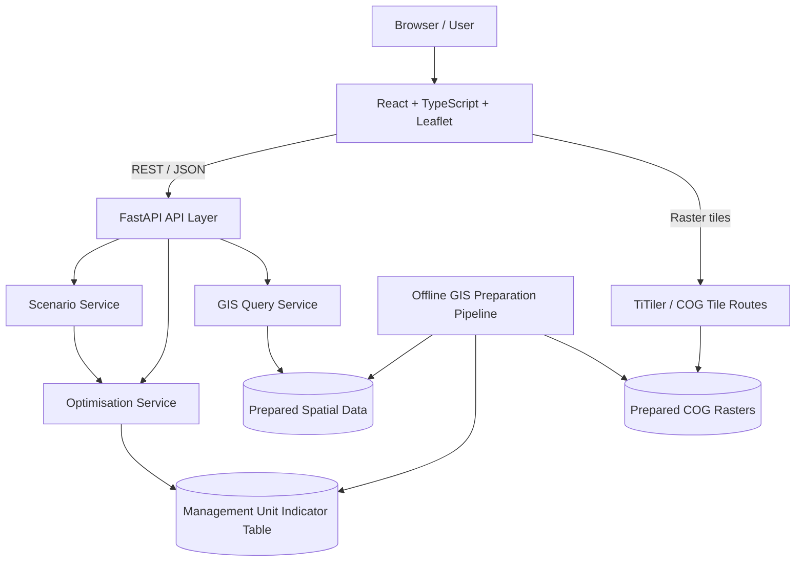

# InvaPlan 项目计划书

> **项目名称**：InvaPlan — Scenario-Based Spatial Prioritisation for Invasive Plant Management  
> **项目定位**：基于既有入侵植物物种分布模型（SDM）研究成果的交互式 Web GIS 决策支持原型  
> **文档版本**：v1.0 · 2026-11-08  
> **目标场景**：University of Glasgow Research Associate / RESPECT WP3 岗位作品集展示  
> **目标交付时间**：2026-11-23（预留 11 月 24 日申请提交缓冲）  
> **实施方式**：个人主导研究与系统设计，借助 Codex 分阶段编码、测试和文档化

## 1. 项目摘要

InvaPlan 是一个通过浏览器访问的 **Web GIS + Scenario Planning + Spatial Optimisation** 原型系统。项目不重新训练入侵植物分布模型，而是复用研究中已经产生的预测栅格、模型评估指标和相关空间变量，将静态科研成果转化为可以配置管理目标、分配有限资源、比较情景及解释空间选择结果的交互式应用。

系统围绕一个明确问题展开：**在管理资源有限、目标偏好不同的条件下，哪些空间单元应被优先纳入进一步调查、监测或管理计划？**

第一版要展示完整的工程闭环：**真实数据 → 离线 GIS 预处理 → Web 地图 → 情景参数 → 后端优化 → 优先区域与权衡分析 → 结果导出**。

### 1.1 项目成功的定义

评审者能够打开在线演示，无须安装科研软件，在同一个页面内：

1. 查看基于既有 SDM 结果的真实空间图层；
2. 选择一种管理情景并调整资源约束及指标偏好；
3. 运行实际求解器，而不是触发预制或随机结果；
4. 在地图上看到被选择的管理单元，并查看每个单元的选择依据；
5. 对比两个情景在选区、资源消耗及目标指标上的差异；
6. 导出结果，并在 GitHub 找到明确的技术说明、限制与可复现操作方式。

### 1.2 与招聘岗位的关联

| 岗位能力 | InvaPlan 的证明材料 |
|---|---|
| Geospatial web applications | React、Leaflet 地图、GeoJSON、栅格瓦片、交互查询 |
| GIS & spatial datasets | Rasterio/GDAL、GeoPandas、坐标转换、区域汇总、数据验证 |
| Software engineering | FastAPI、类型化 API、模块化架构、Docker、自动化测试 |
| Reasoning & decision-making | 情景规则、可审计的目标函数与约束、选择原因解释 |
| Reproducible/scalable solutions | 数据准备脚本、数据契约、配置、版本信息和测试 |
| Environmental research | 真实的入侵植物 SDM 研究与模型不确定性说明 |
| Stakeholder-oriented tool | 非技术用户可操作的参数界面、可解释结果与导出功能 |

> **边界说明**：该产品是独立作品集原型，不属于 RESPECT 项目，也不声称经过土地管理者共同设计、临床式验证或真实管理成效检验。

---

## 2. 软件交付目标与产品形态

### 2.1 交付形式

- **产品形态**：桌面优先（desktop-first）、响应式单页 Web 应用（SPA）。
- **访问方式**：浏览器访问公开 Demo URL；游客模式，不需要注册。
- **技术交付**：单个 GitHub monorepo，包含前端、后端、GIS 预处理、测试、文档。
- **部署交付**：Docker 容器与 `compose.yaml`；生产环境尽量使用单一服务入口。
- **展示材料**：产品截图、60–90 秒使用演示视频或 GIF、架构图、简短项目介绍。

### 2.2 目标用户

- **非技术用户**：研究人员、环境管理者或规划人员，用于探索不同管理偏好的空间优先级。
- **技术评审者**：查看代码、测试、数据流程与 API 设计。
- **科研评审者**：审阅数据来源、模型限制、决策逻辑和结果解释的科学严谨性。

### 2.3 单页面信息架构

| 页面区域 | 主要组件 | 主要任务 |
|---|---|---|
| 顶部导航栏 | Logo、研究区域、数据说明、帮助 | 项目导航和透明度说明 |
| 左侧面板 | Scenario Builder、权重、管理能力限制、运行按钮 | 构造与提交情景 |
| 中央地图 | 基础地图、SDM 栅格图层、管理单元、交互选择 | 空间可视化与探索 |
| 右侧面板 | Summary、Unit Details、Comparison、Export | 解释、对比与导出 |
| 底部/弹窗 | Legend、方法与局限、运行状态、错误反馈 | 方法透明性与可用性 |

**主要用户旅程**：打开地图 → 选择 Baseline → 切换 Early Detection / Containment → 调整参数 → 点击 Run Optimisation → 观察地图变化 → 点击管理单元查看解释 → 对比结果 → 导出。

---

## 3. 范围划分：MVP 与后续版本

### 3.1 v0.1 MVP：必须实现

1. **真实地图**：加载一套已核实的研究区域 SDM 空间图层，并有清晰图例与数据来源。
2. **管理单元**：展示与优化过程一致的候选单元边界，可点击查询属性。
3. **预设情景**：Baseline（不求解，仅作参考）、Early Detection、Containment / Ecological Protection。
4. **参数调整**：用户可调整指标权重和管理能力上限；前后端一致地校验。
5. **真实求解**：Python 后端执行带约束的离散空间单元选择优化。
6. **结果交互**：高亮被选中单元，展示资源使用、指标汇总、单元级解释。
7. **情景对比**：保存至少两个浏览器会话内的结果，比较选中单元的交集与差异。
8. **导出**：JSON/CSV 导出当前情景配置和求解结果。
9. **工程质量**：基础测试、Docker、本地运行说明、数据来源与局限说明。

### 3.2 v0.2：有余力再做

- 额外物种或研究区域切换；
- Polygon 自定义规划范围；
- WMS/WFS 第三方地图服务接入或 Vector Tiles；
- 更精细的空间连续性/连通性约束；
- Pareto 前沿或 ε-constraint 多目标求解；
- 作业队列、结果持久化、云端对象存储；
- 参与式情景配置与用户反馈记录。

### 3.3 明确不做

- 重新运行 BIOMOD2 或训练新的大规模 SDM；
- 用户账户、复杂权限、多人协作；
- 微服务、Kubernetes、分布式任务平台；
- 未经验证的入侵控制效果、碳效益或经济收益模拟；
- 仅为了“AI”标签而增加 LLM；
- 一开始加载全部全球物种结果。

---

## 4. 软件系统架构

采用 **前后端分离开发、模块化单体（Modular Monolith）部署**。业务模块职责明确，但第一版不人为拆成多个微服务。



### 4.1 前端职责

**推荐**：React + TypeScript + Vite + Leaflet（React-Leaflet 可选）。

- UI 状态：当前图层、情景草稿、已提交参数、结果 A/B；
- 地图交互：缩放、图层控制、管理单元高亮、点击查询；
- API 调用：发送请求、展示运行中/错误/成功状态；
- 结果展示：指标卡片、差异图层、对比表、导出；
- **不包含**：核心优化算法、可信的面积统计或任意业务决策结论。

### 4.2 后端职责

**推荐**：Python 3、FastAPI、Pydantic。

- **API Layer**：请求与响应模型、参数校验、HTTP 错误处理；
- **Scenario Service**：预设、权重配置、适用指标与规则描述；
- **Optimisation Service**：纯 Python 优化逻辑，不依赖地图组件或栅格文件；
- **GIS Service**：根据管理单元 ID 读取属性和几何信息；
- **Repository/Data Adapter**：读取本地配置、表格和空间数据；
- **Tile Routes**：对已准备的 COG 提供瓦片服务（可通过 TiTiler 集成）。

**关键设计原则**：优化器只接受规范化管理单元数据及情景约束；它不需要知道 SDM 是由 BIOMOD2、哪种物种或哪种研究区域生成的。

### 4.3 数据层与离线处理

- 原始 SDM 输出仅用于 **离线预处理**；
- 浏览器访问的是瓦片、简化后的矢量管理单元和小规模查询结果；
- 求解器读取的是预先构建的 **管理单元指标表**，不在每次运行中扫描大幅全球栅格；
- 所有原始数据路径由部署配置管理；API 不接受用户指定的任意本地文件路径。

### 4.4 基础部署

- 本地开发：Vite 开发服务器 + FastAPI + 数据目录；
- 正式 Demo：前端静态构建文件由同源服务提供；FastAPI 提供 `/api/v1/*`；地图瓦片通过 `/tiles/*` 路由提供；
- Docker 封装运行依赖；`compose.yaml` 启动应用；
- 不要求 PostgreSQL/PostGIS；第一版使用本地只读 GeoPackage/GeoJSON、Parquet/CSV、COG；
- 公开部署前确认数据许可、体积限制、服务器资源和求解超时。

---

## 5. GIS 科学模块与软件模块的接口边界

这一节只规定**数据契约**，不预先锁定科学方法细节。GIS 指标计算和科学参数选择可独立迭代，软件层保持稳定。

### 5.1 科学侧输入（待按真实文件核实）

- 已有 SDM 聚合预测栅格（例如经过检查的全球相对适宜性图层）；
- 小批量已通过质量检查的物种级 ensemble 预测栅格（可选）；
- 模型评估 CSV（AUC/TSS 等，如实际存在）；
- 已有的土地利用、人类压力、出现记录或生态敏感性数据（仅对可核实数据开放功能）；
- 研究区域边界和单位划分策略。

**不将历史讨论过的文件名、物种数量和字段格式视作已核实的本地文件。** 开发开始时需运行 `gdalinfo`、检查 CSV 列名并生成数据清单。

### 5.2 离线数据准备输出

| 输出 | 格式 | 用途 |
|---|---|---|
| `study_area.geojson` | GeoJSON | 研究范围与地图定位 |
| `management_units.geojson` | GeoJSON | 前端管理单元展示（适当简化） |
| `management_units.parquet` | Parquet 或 CSV | 优化器输入：单元 ID、面积、标准化指标 |
| `layers.json` | JSON | 图层 ID、名称、范围、图例和来源 |
| `scenarios.json` | JSON | 可用情景及允许调整的参数 |
| `suitability.cog.tif` | COG | 地图栅格瓦片来源 |
| `data_manifest.json` | JSON | 数据版本、时间、CRS、NoData、变换及许可 |

数据准备脚本应可重复执行，并报告剔除的无效单元、NoData 区域、输入栅格的范围和数值尺度。

### 5.3 管理单元数据契约（示例）

```json
{
  "unit_id": "unit_001",
  "area_ha": 100.0,
  "eligible": true,
  "indicators": {
    "suitability": 0.82,
    "human_pressure": 0.65,
    "ecological_priority": 0.76
  }
}
```

以上数值仅示意字段结构。生产数据由已核实的 GIS 流程提供；缺少某一指标时，不得生成看似真实的替代数值，应停用依赖该指标的情景或明确使用经过声明的代理变量。

### 5.4 坐标、尺度与科学质量控制

- GeoJSON/API 地理坐标采用 WGS84（EPSG:4326）；
- 面积与距离计算必须在适合研究区域的投影坐标系中进行，不能直接在经纬度上计算面积；
- 若研究范围位于英国，可考虑 EPSG:27700；其他地区选用适用的本地投影或等面积投影；
- 保留 NoData 掩膜，记录 0–1、0–100、0–1000 等原始预测值尺度；
- 明确区分 **相对环境适宜性、观测发生、入侵风险、生态损失、未来干预效果**，不得相互替代；
- 研究区、网格分辨率和单元面积必须与已有 SDM 空间分辨率和研究目标相容；
- 记录模型质量和研究数据的限制，避免将可视化的阈值当作已验证生态学阈值。

---

## 6. 情景与空间优化功能设计

### 6.1 三种情景

| 情景 | 作用 | 是否求解优化 |
|---|---|---|
| **Baseline** | 展示现有研究数据的空间参考图层；不代表未来无干预趋势预测 | 否 |
| **Early Detection** | 在有限监测资源下，优先选择适宜性及相关传播/暴露代理指标较高的单元 | 是 |
| **Containment / Protection** | 在已有证据允许的情况下，重视已发生记录及生态保护优先级 | 是 |

**实现规则**：若现有数据不能支撑“Containment”的出现记录或保护指标，该情景在 MVP 中应改为名称与指标一致的替代策略（例如 *Suitability-focused prioritisation*），不能虚构控制场景证据。

### 6.2 优化目标与约束

每个候选管理单元对应二元决策变量 `x_i ∈ {0,1}`。在明确标准化方式、权重与单位后，以加权指标得分构造目标：

$$
\max \sum_{i=1}^{N} x_i A_i \left(\sum_{k=1}^{K} w_k z_{ik}\right)
$$

约束示例：

$$
\sum_{i=1}^{N} x_i A_i \le B
$$

其中：

- `A_i`：单元面积（ha）；
- `z_ik`：经定义和检验的第 k 个单元指标（例如 0–1）；
- `w_k`：可调整且总和为 1 的非负权重；
- `B`：可纳入管理/监测的总面积上限（ha），**不冒充真实货币预算**；
- 对不可选单元设置 `x_i = 0`。

若管理单元等面积，可将资源上限表示为选中网格数或百分比；若面积不等，则使用实际面积约束。是否乘以 `A_i` 取决于指标解释为“单位面积收益”还是“单元总收益”，需在方法文档中明确，不得重复加权面积。

第一版采用 **SciPy MILP** 或等效的成熟整数规划求解器。必须返回求解状态（optimal / feasible / infeasible / timeout），不能把失败结果显示为成功。

### 6.3 多情景比较的最低标准

每次运行保存可重现的 `ScenarioRun`：参数、数据版本、求解状态、选中单元、目标值、求解耗时及汇总统计。前端至少能对比两次运行：

- 两个情景共同选中的单元；
- 只属于情景 A 或 B 的单元；
- 已使用的管理面积和占比；
- 同一组定义下的指标汇总与差异；
- 参数变化如何改变选区。

**注意**：权重和约束变化产生的是“不同偏好下的优选方案”，不是已验证的干预后生态结果。优化器目标值跨不同权重场景不一定可直接比较，应使用共同定义的外部评价指标进行比较。

### 6.4 Explain My Decision

点击某单元可查看：

1. 单元原始/标准化指标及数据来源；
2. 当前情景的权重与资源约束；
3. 该单元的加权贡献，以及它是否被选中；
4. 简要解释为什么其分数较高或为何受到约束影响；
5. 这是规划辅助信息而非现场管理指令的提示。

“高分”只能解释为符合当前评分规则，不应被表述为算法已证明该单元具有最高真实生态收益。

---

## 7. API 契约（v0.1）

统一前缀：`/api/v1`。响应结构必须由 Pydantic 模型定义，并生成 OpenAPI 文档。

| 方法 | 路径 | 用途 |
|---|---|---|
| GET | `/health` | 存活与数据可读性检查 |
| GET | `/api/v1/metadata` | 研究区域、数据版本、方法和许可 |
| GET | `/api/v1/layers` | 地图图层元信息及瓦片 URL |
| GET | `/api/v1/scenarios` | 预设情景及可调参数 |
| GET | `/api/v1/units` | 当前研究区的管理单元 GeoJSON（按需范围查询） |
| GET | `/api/v1/units/{unit_id}` | 单元属性与解释基础信息 |
| POST | `/api/v1/optimise` | 提交情景并获得求解结果 |
| GET | `/tiles/{layer_id}/...` | 根据白名单图层 ID 返回地图瓦片 |

请求示例：

```json
{
  "scenario_id": "early_detection",
  "weights": {
    "suitability": 0.6,
    "human_pressure": 0.4
  },
  "max_management_area_ha": 5000
}
```

响应示例：

```json
{
  "run_id": "example-run-id",
  "status": "optimal",
  "data_version": "demo-v1",
  "selected_unit_ids": ["unit_001", "unit_008"],
  "summary": {
    "selected_units": 2,
    "selected_area_ha": 200.0,
    "resource_limit_ha": 5000.0
  },
  "warnings": []
}
```

上述 ID 与数值仅用于约定数据结构。实现时需覆盖输入范围、权重归一化、空数据、超时与不可行问题的 HTTP 响应规范。运行耗时应设置上限，避免公开 Demo 被反复提交大规模计算拖垮。

---

## 8. 代码仓库结构

```text
invaplan/
├── frontend/
│   ├── src/
│   │   ├── components/
│   │   │   ├── map/
│   │   │   ├── scenario/
│   │   │   └── results/
│   │   ├── api/
│   │   ├── hooks/
│   │   ├── types/
│   │   └── App.tsx
│   ├── package.json
│   └── vite.config.ts
├── backend/
│   ├── app/
│   │   ├── main.py
│   │   ├── api/
│   │   ├── schemas/
│   │   ├── domain/
│   │   │   ├── scenarios.py
│   │   │   ├── optimisation.py
│   │   │   └── explanations.py
│   │   ├── services/
│   │   │   ├── gis_service.py
│   │   │   ├── data_repository.py
│   │   │   └── tile_service.py
│   │   └── config.py
│   ├── tests/
│   └── pyproject.toml
├── scripts/
│   ├── inspect_inputs.py
│   ├── prepare_data.py
│   └── validate_outputs.py
├── data/
│   ├── raw/               # gitignored；需遵守原始数据许可
│   └── processed/         # 按体积和许可决定是否发布
├── docs/
│   ├── architecture.md
│   ├── methodology.md
│   ├── data_dictionary.md
│   ├── api.md
│   └── screenshots/
├── .github/workflows/
│   └── ci.yml
├── .env.example
├── .gitignore
├── Dockerfile
├── compose.yaml
├── README.md
└── PROJECT_PLAN.md
```

### 8.1 关键软件开发约束

- `domain/optimisation.py` 必须可用合成数据独立单元测试；
- 不在 FastAPI 路由中编写复杂 GIS 或求解器逻辑；
- 前端所有情景输入均由 TypeScript 类型定义，与后端 Pydantic Schema 保持同步；
- 科学配置、数据契约和部署配置分开；
- 数据文件大于 GitHub 合理仓库体积时使用外部发布地址或部署资源目录；
- 前端不能自行计算“官方结果”，后端是分析与求解的单一真实来源。

---

## 9. 开发计划与里程碑

**实际时间窗口**：2026-11-09 至 2026-11-23；2026-11-24 为岗位申请截止日。建议优先保障一个真正运行的 MVP，避免最后几天因新增功能而无法上线。

| 里程碑 | 建议时间 | 主要交付 | 验收门槛 |
|---|---|---|---|
| M0 数据核实与契约 | 11/09–11/10 | 文件清单、栅格元数据、指标可用性矩阵、研究区 | 确定至少一个真实图层与两个可用指标，或调整情景范围 |
| M1 软件骨架 | 11/11–11/12 | React 地图、FastAPI、API Schema、可本地启动 | 地图和 API 正常连通，测试通过 |
| M2 数据接入 | 11/13–11/15 | COG 瓦片、管理单元 GeoJSON、指标表 | 真实地图与单元属性一致，可复现生成 |
| M3 情景优化 | 11/16–11/18 | Scenario Service、MILP、Run API、结果地图 | 调参改变求解结果；返回状态与约束验证 |
| M4 对比与解释 | 11/19–11/20 | 两情景对比、Explain Panel、JSON/CSV 导出 | 地图、汇总和导出相互一致 |
| M5 稳定、部署、作品集 | 11/21–11/23 | Docker、CI、公开 URL、README、截图/视频 | 外部浏览器可访问；冷启动复现说明完整 |

**降级策略**：

- 若 M0 只验证出一个可用指标：先实现“适宜性导向 + 面积资源约束”优化，并在文档中说明无法声称多准则；尽快寻找已存在且可复用的第二指标。
- 若 M2 地图瓦片部署受阻：优先发布裁剪后的 GeoJSON/低分辨率栅格用于小区域演示，同时保留真正的优化 API。
- 若 M4 时间不足：保留两个情景的选区差异与简单文字解释，推迟复杂图表。
- 若公开部署失败：保证 `docker compose up --build` 可本地启动，并录制真实操作视频；但不能宣称已有 Live Demo。

---

## 10. 质量保证与验收

### 10.1 自动化测试

**GIS / 数据**

- 输入 GeoTIFF 坐标系、像元尺度、NoData 检查；
- 使用人工合成几何验证管理单元面积计算与空间重叠；
- 管理单元 ID 与指标表一一对应，重复或缺失 ID 被检测；
- 统一处理缺失值与预测值尺度。

**优化器**

- 在小规模手工可枚举数据集上核对最优解；
- 所有结果满足管理面积上限；
- 权重归一化和非法参数校验；
- 不可行与求解超时状态被正确处理；
- 结果在相同输入、数据版本及求解配置下可重现。

**API / 前端**

- 接口请求响应 Schema 测试；
- 错误提示、加载状态和无数据状态测试；
- 前端地图选区与后端选中 ID 保持一致；
- 导出结果包含情景参数与数据版本；
- 构建和容器启动检查。

### 10.2 版本验收清单（Definition of Done）

- [ ] 公开访问的浏览器界面（或明确标注暂不可公开部署）
- [ ] 至少一个真实且有出处的 SDM 图层
- [ ] 可见、可查询的空间管理单元
- [ ] Baseline 与至少两个可解释的优化配置（若数据支持）
- [ ] 可调整权重与资源约束，后端实际求解
- [ ] 正确显示选中单元、资源利用率和求解状态
- [ ] 两个情景的空间差异与可比指标
- [ ] 单元解释面板、JSON/CSV 导出
- [ ] 数据预处理可重跑，测试结果清楚
- [ ] Docker 部署、README、方法局限和演示材料齐全

---

## 11. 数据、科学与工程风险

| 风险 | 影响 | 应对 |
|---|---|---|
| 现有栅格体积大，前端加载慢 | 地图卡顿或部署成本高 | 裁剪研究区、COG/瓦片、限制默认图层数量 |
| 栅格 CRS、NoData、数值尺度不一致 | 科学结果错误 | 预处理验证脚本、明确 metadata、合成数据测试 |
| 某些情景缺乏对应变量 | 伪造决策依据 | 禁用该情景，或如实改名并解释代理变量 |
| 优化权重缺乏实证依据 | 结论被误读 | 权重定义为用户偏好；做敏感性分析；明确非管理成效预测 |
| 求解复杂度或公开 API 滥用 | Demo 超时 | 限定单元数量、参数范围与求解时间；限流与缓存可后加 |
| 数据再分发许可不清晰 | 不能公开附带数据 | 核验许可，提供取得数据及生成流程，不直接提交受限原始文件 |
| Codex 一次改动过大 | 难以调试和验收 | 小任务、小提交、每阶段运行测试并人工检查科学假设 |
| 最后期限过近 | 作品未能按期上线 | 冻结 v0.1 范围，先打通最短工作链路，再增加非核心功能 |

---

## 12. Codex 协作与开发规范

1. **先核实数据和接口**：不要让 Codex 猜测 GeoTIFF 文件结构、物种数量、模型评价指标或研究结论。
2. **每轮只实现一个里程碑**：先说明计划、拟修改文件、测试策略，之后再动手。
3. **坚持真实代码路径**：功能必须实际接到 API 和输入数据，不用随机结果假装优化完成。
4. **每轮执行检查**：前端 lint/build、后端 pytest、必要的手工测试，并在总结中列出未完成项。
5. **科学内容人工批准**：标准化、权重意义、变量解释、NoData 处理、地图图例必须由研究者审核。
6. **保持可运行状态**：小步提交 Git，保护上一个可工作的里程碑。
7. **记录局限**：README 和软件内都要说明相关性不等于因果关系，优化选择不等于真实生态管理收益。

### 12.1 Codex 开发任务拆分

- **Task A**：初始化前后端工程、健康检查、基础地图布局；
- **Task B**：数据清单工具、COG 转换、管理单元导出与 schema 验证；
- **Task C**：Scenario JSON 模型与界面参数编辑器；
- **Task D**：独立的优化器、约束测试、求解状态；
- **Task E**：API 接入、选区地图、情景 A/B 对比；
- **Task F**：解释、导出、文档、Docker、部署与演示。

### 12.2 第一条 Codex 指令模板

```text
We are building InvaPlan, a portfolio-grade scenario-based Web GIS.
Read PROJECT_PLAN.md first and treat its MVP scope, data contracts,
scientific safeguards and acceptance criteria as the project specification.
Do not retrain existing SDMs. Do not invent raster values, evaluation
metrics, stakeholder evidence or optimisation results.

For the current task:
1. Inspect the repository and report what exists.
2. Propose a small implementation plan and test plan.
3. Implement only the assigned milestone.
4. Run tests/build commands and report exact results.
5. State clearly what requires real data or human scientific review.
6. Keep architecture modular: React UI, FastAPI API, pure optimisation
   module, offline geospatial preparation pipeline.
```

---

## 13. 项目最终交付文件

| 交付物 | 说明 |
|---|---|
| **Live Demo URL** | 评审可直接操作的在线 Web GIS（若部署成功） |
| **GitHub Repository** | 可审查前后端、求解器、测试与 GIS 预处理代码 |
| **Docker Deployment** | 一套可在本地重现运行的软件环境 |
| **README.md** | 产品目标、安装运行、核心功能、截图、数据来源 |
| **docs/methodology.md** | 情景定义、优化目标、约束、假设与限制 |
| **docs/architecture.md** | 软件结构图、依赖关系与 API 数据流 |
| **docs/data_dictionary.md** | 指标字段、单位、标准化规则、NoData 和版本 |
| **Tests / CI** | 证明关键功能可验证的自动化测试 |
| **Demo Video** | 约 60–90 秒展示操作闭环 |

### 13.1 用于申请材料的成果陈述（完成后才可使用）

> Designed and developed an interactive Web GIS prototype that integrates existing species distribution model outputs with scenario-based spatial prioritisation. The application combines a React/Leaflet frontend, a FastAPI backend, reproducible geospatial data processing and constrained optimisation to compare management priorities under alternative objectives and resource limits.

根据实际完成情况删减未实现的技术和功能，不在申请材料中使用尚未交付的描述。

---

## 14. 第一阶段行动清单

**第一件事不是写 UI，而是确认已有科研产物是否能支持至少一个真实优化案例。**

- [ ] 指定一个数据最完整的研究区（不要求全球范围）。
- [ ] 提供一个主 SDM GeoTIFF 的 `gdalinfo` 输出。
- [ ] 确认研究区内能否提取至少两个独立且有明确意义的指标。
- [ ] 查清模型评估表的字段、数据版本及 NoData 处理方式。
- [ ] 决定管理单元划分方式和单元面积上限定义。
- [ ] 确定第一版两种优化策略的真实可用指标。
- [ ] 固定输入/输出数据 Schema；随后交给 Codex 实施 M1。

**最终项目判断标准**：不是界面功能多，而是以真实、可信的研究成果为基础，完成一次可解释、可重复、可对比的空间优化决策流程，并且代码足够清晰，能够向招聘方证明 Web GIS、软件工程与环境决策支持能力。
